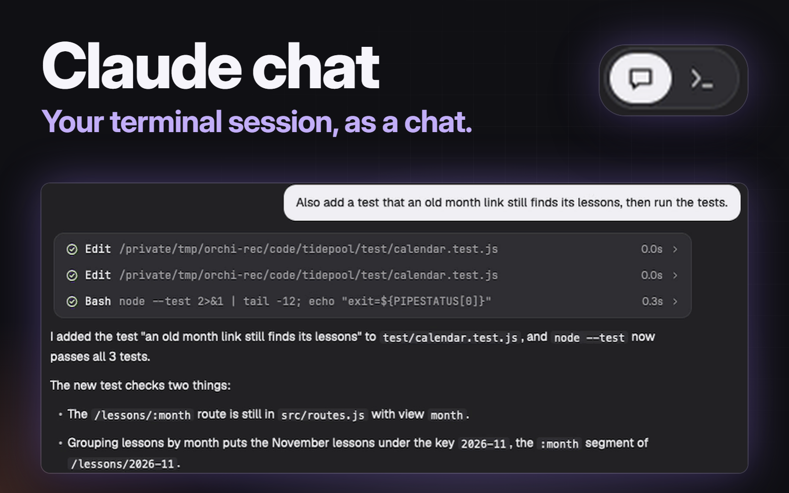

# Claude chat

A chat pane for a live Claude Code session. A small two-icon toggle sits at the right of the tab row. Press it, or `ctrl-shift-j`, and the terminal running Claude Code swaps for a chat view of the same session: your messages as bubbles, replies as formatted text, tool calls as lines you can open, code as cards you can copy. You type in a box at the foot, answer permission prompts on cards, and press again to get the terminal back. The session never stops. It runs on macOS only.



## What you see

**The toggle.** A block 84px wide at the right end of the 42px tab row, on `chrome` with a 1px `border` line along its foot. Inside it, right-aligned with 10px to spare, is a pill 30px high: `surface`, 1px `border`, radius 15, 2px padding. It holds two 30×24 cells, chat on the left and terminal on the right, each with a 14px icon. A 30×24 thumb in `solid` sits behind the side showing, and that side's icon turns `background`. The other icon is `muted`. The pill shows only while the focused pane is a Claude Code session on this machine, or that session's chat. Anywhere else the block is empty.

**The chat pane**, on `canvas`, in `foreground` at 14px, top to bottom:

- **The thread** fills the pane. Everything sits in a centred column 85% of the pane wide, never under 800px or over 1400px, with 24px at each side. A narrow pane just fills.
  - Your messages: right-aligned bubbles, `solid` with `solid_foreground` text, radius 14, 14×9px padding, up to 85% of the column. A message sent but not yet in the transcript draws at 60% opacity.
  - Replies: Markdown, 14px on 23px lines, selectable.
  - Tool calls: 30px lines in one `background` card, 1px `border`, radius 12. Each line has a glyph, the tool's name in JetBrains Mono, its target in `dim`, how long it took, and a chevron. The glyph is a tick in `done`, a cross in `blocked`, a spinner while running, or a dot if the turn ended first.
  - Code: a card with a 33px band showing the language and Copy, and a body of 12.5px JetBrains Mono on 20px lines in theme colours.
  - Quiet lines at 12.5px in `dim`: command output, "Conversation cleared", and each turn's end, as `Worked for 1m 27s · 15:56`.
  - The status row while a turn runs, 24px high: a spinner in `accent` cycling `· ✢ ✳ ✶ ✻ ✽` every 110ms, the session's own status text at 13px in `muted`, and the seconds so far in `dim`.
  - With nothing to show yet, a line in the middle of the pane: `…`, or `Transcript unreadable`.
- **The panel slot**, between the thread and the foot, empty until needed. It holds the permission and question cards, the usage panel, the `/` list and the "End this session?" card, all on the column's edges.
- **The composer**, 24px from the sides and 14px from the bottom: `surface`, 1px `border`, radius 14.
  - Queued messages, when there are any, in a tray of rows at the top. The first row has Edit and a solid `Send now` pill marked `⌃↵`, and every row has a remove button.
  - Images waiting to go, as 44px thumbnails with a remove button.
  - The text box, 14px, placeholder `Reply`, growing from 1 to 10 rows.
  - A note at 12px in `muted`, when there is one, such as `A dialog is open in the terminal`.
  - The bottom row, 40px: on the left a context gauge of 13 ticks with its percent, on the right the model and effort control, then a 30px round `solid` send button with an arrow.

**The model pad** opens above the model control: a 324px `popover` card with the model and effort as its heading, and a 246×144 field of dots. Each row is a model, and the columns are Low, Medium, High, xHigh and Max. A 22px puck marks the choice.

**The usage panel** is a `background` card, radius 14, with a 41px "Usage" header, refresh and close buttons, and at most 56% of the pane's height. At the top are the limits: a label, a percent and an 8px bar each, with `↻ Sep 21 at 9am` below. The bar is `done` under 80%, `ansi3` under 100% and `blocked` at 100%. Below them are two tabs. "What's using it" has request and session counts, Last 24h and Last 7d, advice rows with bars, and top skills and subagents. "Stats" has a grid of active days, eight figures and token totals for All time, Last 7 days and Last 30 days.

## How it behaves

- **The swap.** A first press splits a chat pane to the right of the terminal, then zooms and focuses it, so the chat fills the tab. Later presses zoom and focus whichever side you asked for, and the keyboard goes with it. Pressing the icon already showing does nothing. `ctrl-shift-j` always goes to the other side. The thread fades in under a cover in its ground colour. Two sessions in one tab each keep their own chat.
- **Agent status.**
  - `working`: the status row shows, and the send button becomes a square Stop button while the box is empty.
  - `blocked`: the status row reads `Waiting for you`, and a card opens in the panel slot.
  - `done` and `idle`: no status row. Nothing else in the pane changes.
- **Cards.** Every word on a card is read from the terminal's screen. A press works after the card has been up for 400ms. The screen is read again first, and the key goes only if the same dialog is still there. Keys `1` to `9` and Esc work when the composer is empty. With text in it, keys stay typing and the card takes presses only. A dialog the pane can't read, such as a plan or a multi-select, swaps to the terminal and the status row reads `Waiting for you in the terminal`.
- **Sending.** Enter sends and Shift+Enter makes a new line. During a turn a message queues and shows in the tray. Ctrl+Enter sends the queue now. Text half typed in the terminal's own prompt is set aside first and comes back after. A send that can't go puts the text back in the box and says why.
- **Images.** Paste with the usual key, or drop an image file. Any other dropped file goes in as its path.
- **`/` commands.** Typing `/` and a name opens a list grouped as This session, In the chat, Skills, Opens the terminal and End. Up, Down, Tab, Enter and Esc work it, and a press picks a row.
  - `/usage` opens the usage panel and `/stats` opens it on Stats. With the panel open, `/usage` closes it. `/stats` moves to Stats, or closes it if Stats is showing.
  - `/model` and `/effort` open the pad, or with a value change this session only. They are never typed into the terminal, where a value would save a default for new sessions.
  - `/tui` and `/terminal` swap.
  - `/exit` and `/quit` ask first: `Keep going` or `End session`.
  - `/permissions`, `/memory`, `/status`, `/hooks`, `/plugin`, `/resume`, `/rewind`, `/add-dir`, `/ide`, `/statusline`, `/login`, `/logout` and `/vim` go to the session, then swap, because they open a dialog.
  - Anything else goes to the session and is looked at after 2 and 5 seconds, in case it opened a dialog.
- **The pad.** Press or drag in the field, or use the arrow keys. Enter or a press outside applies the choice once the session is between turns, and `…` on the control means it's waiting. Esc closes it and applies nothing.
- **The thread.** It stays on the newest message unless you scroll up. Scrolling to the top loads older messages, 60 at a time. A press on a tool line opens its result. Copy puts the whole block on the clipboard and reads `Copied`, or `Copied part` if only the cut version could be read. `/clear` and `/resume` move the pane to the new transcript.
- **Motion.** New reply text sweeps in line by line behind soft-edged covers, and the list glides down after it. Other rows fade and rise 6px. Tool lines, cards and panels spring open. Rows that land while the terminal is showing are simply there when you come back.
- **Closing.** When the terminal ends, its chat closes itself.

## Built from

One mod, `mods/claude-chat/`, with `mod.json` set to `{ "place": "none", "title": "Claude Code" }`, in two roles:

- **Chat pane.** `pane.split` makes it with `props: { terminal: "<address>" }`.
- **Toggle.** A layout block with `props: { "role": "toggle" }`. `main.js` checks the role first and hands the copy to `toggle.js`. That copy owns `swap.js` and listens for `swap` from `nextCommand()`.

Adding it to a window:

1. Copy `mods/claude-chat/` to `mods/`.
2. Merge `keys.json`: `{ "global": { "ctrl-shift-j": "claude-chat.swap" } }`. Herdr's default keys don't use `ctrl-shift-j`, but ask first if the person's do.
3. Clone the layout, which also switches to it: `herdr-app do layout.clone '{"name":"main","as":"main-chat"}'`. The `tabs` mod needs no clone.
4. In `layouts/main-chat.json`, replace the `tabs` block in `work` with this row:

```json
{ "id": "tabs-row", "type": "row", "size": { "px": 42 }, "resizable": false,
  "children": [
    { "id": "tabs", "type": "block", "window_drag": true, "content": { "mod": "tabs" } },
    { "id": "chat-toggle", "type": "block", "size": { "px": 84 }, "window_drag": true,
      "content": { "mod": "claude-chat", "props": { "role": "toggle" } } } ] }
```

The layout's shipped `pane` header stays as it is.

The rest:

- Files: `main.js` holds the pane's state. `session.js` finds the session. `tail.py` reads the transcript and `longest.py` the longest sessions. `rows.js` and `thread.js` are the thread. `composer.js` and `send.js` send. `cards.js` and `dialog.js` are the cards. `commands.js`, `route.js`, `slash.js` and `usage-*.js` are the `/` commands and the usage panel. `model-control.js`, `pad.js` and `picker.js` are the model pad. `reveal.js`, `motion.js` and `covers.js` are the motion.
- `herdr`: `appHome`, `exec`, `hc`, `home`, `nextCommand`, `panes`, `props`, `readTextFile`, `run`, `setShared`, `settings`, `shared`, `spaces`, `terminals`, `theme`, `watchFolder`, `writeTextFile`.
- `gpui-base`: `v_virtual_list`, `VirtualListScrollHandle`, `Scrollbar`, `TextView`, `Editor`, `EditorState`, `Textarea`, `TextareaState`, `h_flex`, `v_flex`.
- Commands: `pane.split`, `pane.zoom`, `pane.focus`, `pane.close`.
- Shared state: `chatpane.pairs`, `{ [chat pane]: terminal address }`, because `panes()` doesn't give a mod pane's props. `chat.unseen`, `{ [terminal address]: count }`.
- `hc`: `get`, `read`, `send`, `keys`, `interrupt`, `wait`.
- Programs: `python3`, `zsh`, `sh`, `osascript`, `mkdir`, `cp`, `rm`, `find`, `sleep`. `zsh` starts `claude -p`.
- Art: ten 1-colour SVGs in the mod folder (`arrow`, `chat`, `check`, `close`, `copy`, `cross`, `dot`, `refresh`, `terminal`, `tick`), plus `mods/files/chevron-down.svg` and `chevron-right.svg` from the shipped `files` mod.

## Watch out

**macOS only.** Pasting an image uses `osascript` with AppKit, the `/` list and usage read use `zsh`, and the file steps assume `sh`, `cp --` and `find -mmin`. It has not been built for Linux or Windows. The toggle also ignores sessions on other machines.

**What it runs. Warn the person before adding it.**

- `python3 -I -S tail.py` on every transcript read, and `python3 -I -S longest.py` each time the usage panel opens or refreshes.
- `zsh -ic` running `claude -p --no-session-persistence --input-format stream-json --output-format stream-json --verbose` with `/usage` as its message. It runs the first time `/` is typed in a folder, and each time the usage panel opens or refreshes. It loads `~/.zshrc`, and it runs that folder's Claude Code settings and hooks, plus whatever network calls Claude Code makes at start. `/usage` costs no turn. It runs only in a folder the person has already trusted, and a watchdog stops it after 20 seconds.
- `osascript` to read an image from the clipboard.
- `sh -c 'ls -t ...'` to find a transcript by id.
- `mkdir`, `cp`, `rm` and `find` in the image folder, and `sleep` for pauses.
- `hc get`, `read`, `send`, `keys`, `interrupt` and `wait` on the session's terminal.

**What it reads.**

- `~/.claude/sessions/<pid>.json`.
- The session's transcript under `~/.claude/projects/`, which holds the whole conversation and tool results.
- Every transcript changed in the last 30 days, for Longest session.
- `~/.claude.json` and `~/.claude/.claude.json`, for `hasTrustDialogAccepted` only. These files hold other account details.
- `~/.claude/stats-cache.json`.
- The terminal's screen, through `hc read`.

**What it sends and writes.** The mod makes no network calls itself. What you type goes into the terminal with `hc send`, and from there to Claude like anything typed in the terminal. Card presses and model changes are key presses into the same terminal. Pasted and dropped images are copied to `chat-images/` in Herdr's home folder, mode 700. They're deleted once sent, removed or the pane closes, and any left behind go after 7 days. Copy writes the clipboard. Everything read from a transcript or a screen is drawn as text.

**What it assumes.**

- Claude Code reports its status to Herdr with `app` as `claude-code`. Without that the toggle never shows.
- Sessions use `~/.claude`. A session under `CLAUDE_CONFIG_DIR` isn't found until that folder is added to `CONFIG_DIRS` in `session.js`, as a path from the home folder.
- `claude` is on the path in an interactive `zsh`. If it isn't, the `/` list has only its built-in commands and the usage panel reads `Couldn't read`.
- The model control and context gauge read the session's status line, in the shape `model: Opus 5.5 - high  context: 12%`. Without such a line they read `Model` and `-`, and the pad starts on its first row at High. Changing the model still works.
- Cards, the queue and the pad read Claude Code's screens, as drawn by version 2.1.316. A dialog that reads differently goes to the terminal.
- A Claude Code started from inside another one saves no transcript, so its chat stays empty.

**Limits.**

- The bars need a trusted folder and a good `/usage` read, or they read `Limits unavailable`.
- Reset times are the words `/usage` prints, without the time zone. There's no projection of where a limit will land.
- `/usage` shows a bar only for limits the plan has.
- A reply from `tail.py` stays under 900,000 bytes. Text is clipped at 16,000 characters and a tool result at 24,000.
- 64 code cards get colour. Past that the oldest off screen lose it.

**What's missing without a custom pane header.** The shipped `pane` header draws a chat pane from what `panes()` gives a mod pane, which is its `title` and little else. Compared with a header made for this mod:

- No folder on the chat's header.
- No status on the chat's header: no spinner, no `Needs you`.
- No "N new" count. `chat.unseen` is kept up to date, but nothing draws it.
- The header's split, zoom and close buttons show on hover on the chat too. Its zoom button undoes the swap's zoom, leaving both side by side, and the toggle still works from there.

**Keys and copies.**

- `<mod>.<command>` reaches shown copies only, and every chat pane is a copy of this mod. Each chat pane ignores `swap`, and only the toggle acts. A chat behind a zoom gets nothing, which is why the swap can't live in a pane.
- So the key needs the toggle block in the layout on screen. In a layout without it, `ctrl-shift-j` does nothing.
- Without the toggle nothing writes `chatpane.pairs`, so a chat pane made by hand counts as hidden.

**If the name `claude-chat` is taken.** It is written into `main.js`, `commands.js`, `cards.js`, `thread.js`, `toggle.js`, `usage-view.js`, `swap.js`, `dialog.js` and `keys.json`, as asset paths and as the mod name `panes()` reports. Rename all of them.

**What tripped the build.**

- `readTextFile` stops at 1 MiB and transcripts run to 55 MB, so they're read through `exec`. `exec` stops at 30 seconds, which is why the watchdog is at 20.
- A mod has no `setTimeout` or `clearTimeout`. The headless read once raced `exec` against `setTimeout`, and `clearTimeout` threw, so every `/usage` read and the `/` list's commands failed. The watchdog and `exec`'s own limit are what end a slow read.
- `.child(null)` throws and stops the render. Filter a list of optional parts into `.children()`.
- An error in a `v_virtual_list` row blanks the list with no error shown. Rows catch their own and draw `Unreadable row`.
- Use `v_virtual_list`, not `list`, which can't be scrolled from code.
- `on_size_change` and list sizes are in window pixels, and `.h()` is in the app's. Divide by `settings().zoom`.
- A render over about 55 ms is stopped and the last frame stays, so a one-second timer asks again until one finishes.
- A hidden pane doesn't render, so its timers have to notice being hidden.
- A `Textarea` binds Enter, the arrows, Tab and Esc itself. Take them with `cx.bind_keys` and `key_context`, and only while something wants them.
- `TextareaState` and `EditorState` are made in `init` or handlers, never in `render`.
- A press acts on mouse down: in testing, a click didn't always arrive during a turn.
- `test-hook.js` does nothing unless Herdr's home path contains `/.config/hd/`. There it reads `chat-test.json` and `chat-script.json` and writes `chat-state-<time>.json`, all in that home.

## Done when

- `herdr-app check mods/claude-chat` passes, and `herdr-app status` reads `"errors": []` with `main-chat` showing.
- With the repo's `tests/` beside `mods/`, `node --test tests/*.test.mjs` passes. It needs Node 22.15 or later.
- With a Claude Code session focused, the pill shows at the right of the tab row. Focus a plain shell in the same tab and it goes.
- The first `ctrl-shift-j` splits, then the chat fills the tab with the thread at its newest message. Press it again and the terminal is back at full width, with the keyboard in it.
- Pressing the icon already showing does nothing.
- With two sessions in one tab, each with its chat open, the key swaps only the focused one, once.
- A message typed in the box and sent shows as a bubble at 60%, turns solid when it reaches the transcript, and the reply appears below it.
- During a turn the status row shows and Stop ends the turn. A message sent during the turn appears in the tray.
- A permission prompt in the session opens a card in the chat with the terminal's own words. Pressing `1` answers it, and the terminal shows the same answer.
- `/` opens the list. `/usage` in a trusted folder shows the limit bars, and What's using it fills in within 20 seconds. If the read fails, the tab says why after `Couldn't read:`, and any limits it did get still show. In a folder that isn't trusted it reads `Folder not trusted` and `claude -p` doesn't run.
- `/permissions` swaps to the terminal with the dialog open within 10 seconds, because the send has to land first. No bubble is left in the chat.
- A press on a tool line opens its result. Copy on a code card puts the block on the clipboard.
- `/model` opens the pad. Picking a row changes this session's model, and a new session keeps its default.
- A pasted screenshot shows as a thumbnail, goes with the message, and its file leaves `chat-images/`.
- `hc kill` on the session closes its chat pane.
- The window restarted with the chat showing brings the chat back, zoomed, with the toggle on the chat side.
