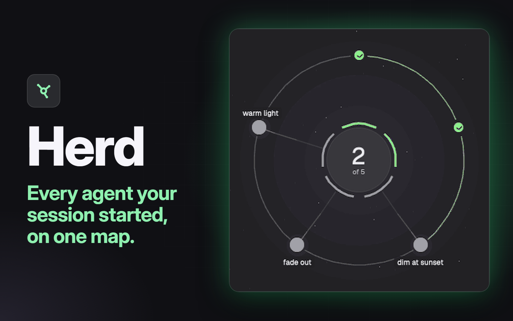

# Herd

A side panel, next to Files and Changes, that shows everything the Claude Code session in view has started. A round map shows the session in the middle and its workers on an orbit. Below it, each agent gets a row saying what it's doing now, over a ribbon of its last 30 minutes. Anyone who needs you gets a red card at the top, and the Herd button in the tab bar shows a red count even while the panel is closed.



## What you see

The panel fills its block on `background`, base text 13px. Colours are theme names only. Top to bottom:

- **Header:** the session's name (15px semibold), and under it, in 12px `muted`, "2 running · 14m". At the right, a 28px icon button with arrows: `expand.svg`, or `collapse.svg` while at full width.
- **Problem line**, only after a read goes wrong: 12px text on `blocked` at 12% alpha, radius 8, over the last good read.
- **Needs you:** one card per blocked agent, on `blocked` at 15% alpha with a 40% `blocked` border, radius 8. Its name (semibold), the reason in 12px `muted`, and a solid `Show` button.
- **The map:** a square on a `canvas` well, radius 12, 8px in from the sides. In a side panel it's 220 to 340px. At 700px wide or more the map moves to the left, up to 460px, with the rows beside it.
  - The sky: 46 faint stars and three soft `accent` circles.
  - The middle: a `raised` circle, a quarter of the map and at least 56px across. It holds the count of agents going, with "running" under it in 11px `muted`. A session on its own also gets its word, such as `Shell`, in that word's colour.
  - A 3.5px ring round the middle: one segment per worker, pointing at it, in its colour. With no workers it's a whole ring, in the session's colour when it's on its own, else `popover`.
  - The session's own subagents: short 2.5px arcs just outside that ring, one each, from twelve o'clock in the order they started, up to 24.
  - The orbit, 40px in from the map's edge: a 1px `border` circle, or with two or more workers, 1.6px arcs from one worker to the next at 47% alpha.
  - Workers: one node each, clockwise from twelve o'clock, 20 to 30px across, growing with the size of the transcript. Each is filled with the colour of what it's doing, holds that activity's icon (`tone-think.svg`, `tone-read.svg`, `tone-write.svg`, `tone-shell.svg`, `tone-wait.svg`), and has a label in 12px medium on a `canvas` chip, 96px wide. A blocked node shows `!` and a `blocked` label.
  - Spokes from the middle to each worker, 1.5px, brighter towards the node.
  - Round a worker: the same arcs for its subagents, and 7px squares in `muted` going round for its processes. Round the middle, the session's processes do the same.
  - Past 28 places, the last node is 18px and reads `+N`.
- **Time axis**, 20px: "30m", "20m", "10m", "Now" in 11px `dim`.
- **Rows**, scrolling, one per worker with the session first, each under a `border` line:
  - Line one: the title (13px semibold), the word (12px medium, in its colour), how long in 12px mono `muted`, and the percent of the context window in 12px mono `dim`, or `ansi3` from 60%. The session's title is "This session" until it has started a terminal, then "Orchestrator". Everyone else's is their name.
  - The ribbon: 9px high, radius 4.5, on `canvas`, with now at the right. A bar per tool call in its colour, thin `border` lines at 10 and 20 minutes, and gaps for thinking. A short Agent or Skill call is a 2px `foreground` tick. Calls that ended over 12 seconds ago are at 66% alpha.
  - Line three, if there's anything to say: the agent's status message in 12px `muted`, and once a turn is over, what it came to at the right, such as `4m 10s, 12 tools, 1 failed`.
- **Under a row**, if it has any: a 26px band, such as "2 subagents, 1 process", with a chevron and up to 12 dots at the right, round for agents and square for processes. Past 12 it adds `+N`.
- **Finished**, at the foot of the list, if anyone has: a 34px band with a chevron, "Finished" and a count.

Colours: writing `ansi3`, shell `accent`, reading `ansi6`, thinking `working`, waiting `dim`, other tools `muted`, a skill `foreground`, needs you `blocked`, quiet `ansi1`, idle `dim`, processes `muted`.

Until a Claude Code session has been in view it shows only "No session", centred, in 12px `muted`.

## How it behaves

- **Agent status**, from `hc get`:
  - `working`: the row's word comes from the open tool call. `Reading`, `Writing`, `Shell`, `Skill` or `Working` for any other tool. With no call open it reads `Thinking`. An open Agent call reads `Waiting`, and so does a shell command that only waits (`hc wait`, `herdr agent wait`, `herdr pane wait`, `gh run watch`, or a command starting `sleep`).
  - `blocked`: `Needs you`, the red card, a `!` node that glows on a 0.8s loop, and sorted first among its siblings.
  - `idle` and `done`: both read `Idle` in `dim`. Herd doesn't tell them apart.
  - Quiet: a working session with no tool open and nothing written for 3 minutes reads `Quiet` in `ansi1`.
  - A terminal that has ended moves to Finished.
- **Who is in view:** it follows the focused pane if that's a local Claude Code session, else the first one in the focused pane's tab. Focus on a worker and it still shows the whole herd from the top. With no session in the focused tab it stays on the last one.
- **Who counts:** the tree comes from `parent` in `hc ls --all --json`, up to 6 deep. A terminal running Claude Code is a worker. Anything else is a process, other coding agents included. Subagents come from the transcript folders. Only workers directly under the session get a place on the orbit.
- **Press a node or a row:** it's selected, its details open by sliding, and any other open details close. A second press closes them. Details are the full status, the command for a process, the model, five effort bars, the time so far, the last turn, and `Show terminal`.
- **Show and Show terminal:** `terminal.peek` over the tab.
- **Press a call on a ribbon:** a line under the ribbon names it, such as `Bash git push`, with how long it took and how long ago, and a `foreground` mark shows on the ribbon. A press within 4px counts. A second press, or a press on the line, hides it.
- **Bands:** a press folds or unfolds. Under a worker it opens smaller rows with 5px ribbons. Under Finished it opens 26px rows: name, a 4px bar sized against the longest (`done`, or `blocked` if the terminal exited with an error) and the time. Past 40 the last line reads `+N`.
- **The arrows:** the panel takes the room of the terminals, which are hidden. Pressing them again brings the terminals back and the panel back to its old width. So does closing the panel or opening another one, within a second. The key action `herd.full` does the same as the arrows while the panel shows.
- **Herd button:** a press opens the panel, and a second closes it. It shows a 16px `blocked` pill with how many in the herd in view are blocked, worked out on every render, so it's right while the panel is closed or has never been opened.
- **Motion:** every worker's node glows on a 2.4s loop. A comet goes round the orbit every 11s and the middle glows on a 3.2s loop while anyone is working. Each new tool call sends a spark along a spoke over 1.2s, up to 8 per read, 110ms apart. A worker's calls, and its subagents', go in to the middle. The session's own calls go out to a worker. Calls by the session's subagents send none.
- **Refresh:** a read every 3s, one at a time, and at once when the session in view changes or the panel comes back into view. The clocks tick once a second. Nothing is read while the panel can't be seen, or once the whole herd has finished.
- **When a read fails:** the red line says what went wrong and the last good read stays. A session missing from a read shows "Session not found. Retrying", and three misses in a row clear the panel to "Session closed". A clock tick over 2 minutes late means the machine slept, and that stretch isn't counted as quiet or in any time shown.

## Built from

- One mod, `mods/herd/`, with `mod.json` `{ "place": "none", "title": "Herd" }`:
  - `main.js` does the reads and holds the state.
  - `model.js` works out the tree and the rows, and `score.js` the ribbons, words and map positions.
  - `view.js` draws, with `poll.js` for read guards and sleep gaps, `usage.js` for context and turn figures, and `session.js` to find a terminal's session.
  - `herd.py` reads the transcripts.
  - `herd-badge.js` isn't used by the mod itself. It goes in the tab bar clone.
  - Art: `herd.svg` (three dots round a circle, 16px stroke icon), `expand.svg`, `collapse.svg`, `orbit.svg` (the comet) and the five `tone-*.svg`. It also draws `mods/files/chevron-down.svg` and `chevron-right.svg` from the shipped `files` mod.
- No `props`. No `keys.json`: bind `herd.full` yourself if you want a key.
- A layout, cloned from `main`:
  - `{ "id": "herd", "type": "block", "content": { "mod": "herd" } }` added to the `panel-body` stack after `changes`. The id must be `herd`.
  - `panel`'s `max` raised from 900 to 6000.
  - The `tabs` block's `content.mod` set to the clone below.
- A clone of the shipped `tabs` mod, with `herd-badge.js` copied in beside its `main.js`, and these changes:

  ```js
  import { spaces, panes, terminals, run, openOverlay, theme, window, shared, layout, settings } from "herdr";
  import { herdBlocked, sessionOf } from "./herd-badge.js";

  const enabled = [...new Set([...(shared("workspace.panels") ?? ["files", "changes"]), "herd"])];

  const panelButton = (id, label, icon, badge = 0) => {
    // ...as shipped, then on the end of the chain, after .child(label):
    .when(badge > 0, el => el.child(div().min_w(16).h(16).px(4).flex().items_center().justify_center().rounded(8)
      .bg(t.blocked).text_color(t.background).text_size(11).font_semibold().child(String(badge))));

  // After the Changes button:
  .child(panelButton("herd", "Herd", "mods/herd/herd.svg", herdBlocked(terminals(), sessionOf(panes()))))
  ```

- `herdr`: `appHome`, `exec`, `hc`, `home`, `layout`, `nextCommand`, `panes`, `readTextFile`, `run`, `setShared`, `settings`, `shared`, `theme`. Commands: `layout.show`, `layout.hide`, `layout.resize`, `terminal.peek`. Shared key: `herd.panelWidth`, the panel's width while at full width, null otherwise.
- `gpui-kit`: `View`, `div`, `svg`, `PathBuilder`, `window.paint_path`, and `.transition`, `.spring`, `.loop`, `.spin`. `gpui-base`: `v_flex`, `h_flex`.
- Programs: `hc ls --all --json`, `hc get <terminal> --json`, and `python3 -I -S mods/herd/herd.py --since <ms> --session <json>`, one `--session` per live agent with a session file.
- `herd.py` looks in `~/.claude`, at `projects/*/<session>.jsonl` and `<session>/subagents/agent-<id>.meta.json` with `agent-<id>.jsonl` beside it. `session.js` finds the session from `~/.claude/sessions/<pid>.json`, using the terminal's foreground pid.

## Watch out

- **Tell the person before adding it.** The mod runs `python3` and `hc`, and it reads Claude Code's transcripts and session files in `~/.claude`, outside its own folder. It only reads them. From each call it keeps the tool and a few words: a path, a command's program and subcommand, a search pattern or query, a web host, a skill name or a description. The rest of a command isn't kept. It writes no file and reaches no network.
- **macOS only.** It has been built and run on macOS only. It calls no Mac-only program, but it hasn't been tried on Linux or Windows, and its paths assume `/`. `python3` must be on the PATH, which on a stock Mac means the command line tools.
- **Claude Code only.** Only a terminal Herdr reports as `claude-code` counts as a session or a worker, and only on this machine. A remote session is skipped.
- **The config folder is `~/.claude`, and nothing else.** It doesn't read `CLAUDE_CONFIG_DIR`. If Claude Code keeps its files elsewhere, change `CLAUDE_DIR` at the top of `session.js`. Otherwise rows still show from `hc`, with no ribbon, model or context figure, and no error.
- **The transcript formats aren't a public interface.** It relies on `sessions/<pid>.json` having `sessionId` and `startedAt`, the `turn_duration` lines, the `subagents` folder and `finished` in its meta files. If Claude Code changes these, ribbons or subagents go quiet.
- **Shipped layouts and mods refuse structural edits.** Clone first:
  `herdr-app do layout.clone '{"name":"main","as":"main-herd"}'` and
  `herdr-app do mod.clone '{"name":"tabs","as":"tabs-herd"}'`, then edit the clones.
- **`panel` stops at 900px in the shipped layout.** Without the higher `max`, full width stops there.
- **Keep `herd` in the clone's `enabled`.** A panel missing from `shared("workspace.panels")` is closed by the tab bar on every space switch, and that value isn't re-read if `shared.json` is edited by hand.
- **Herd brings the terminals back itself.** The tab bar knows nothing of full width. The 1 second clock keeps running while the panel is hidden, and it restores `main` when `herd.panelWidth` is set, `main` is hidden and Herd isn't showing. So for up to a second after closing the panel the work area is empty, and after opening another panel, that panel is full width. Something else hiding `main` is left alone, because no width was saved.
- **The badge can't come from the panel.** A mod copy doesn't start until it's first shown, so the count has to be worked out in the tab bar, and a mod can't import from outside its folder. That's why `herd-badge.js` is copied.
- **It needs the ids `main`, `panel` and `panel-body`.** In a layout without them the panel reads nothing.
- **The context figure is a guess at the window.** The transcript names the model but not its window. It takes 1M for a model from generation 5 on, one marked `[1m]`, or one seen past 200k in the herd, and 200k otherwise. The figure is a share of 80% of that.
- **Zoom:** a path's numbers are the app's own pixels, and the app scales them. A press's `local_position` and `bounds`, and `on_size_change`, are window pixels. Don't scale paths, keep a press as a share of `bounds`, and divide reported sizes by `settings().zoom`.
- **Animate natively.** The panel renders once a second, and all motion uses `.transition`, `.spring`, `.loop` and `.spin`. The clock's `cx.notify()` also brings a render back after Herdr stops one at about 55ms.
- **`exec` stops at 30s.** `hc` calls give up after 8s and `herd.py` after 20s, and the next read starts as normal.
- **Limits:** the last 3 MB of a transcript and 512 KB of a running subagent's log, 300 calls per agent, 60 subagents per session, 6 cleared transcripts walked back with at most 60s between them. Two sessions in one folder could be mistaken for each other across a `/clear`.

## Done when

- `herdr-app check mods/herd` and `herdr-app check mods/tabs-herd` pass.
- The tab bar shows Herd after Changes. A press opens the panel at 368px, and a second press closes it.
- Opened for the first time with a plain shell focused and no Claude Code session in its tab, the panel reads "No session".
- With a Claude Code session focused, the header shows its name and "1 running", the middle reads `1` and "running" and a word, and one row titled "This session" has a ribbon that gains a bar within 3 seconds of a tool call.
- Ask that session to start a subagent: while it runs, an arc shows round the middle and the row gains a band reading "1 subagent". Once it ends, it's under Finished.
- Have that session start a second Claude Code with `hc run`: a node appears on the orbit, the title changes to "Orchestrator", and that worker gets its own row.
- When a session waits on a permission prompt, a red card appears with `Show`, and the Herd button shows 1, with the panel closed too. `Show` peeks at the terminal.
- A press on a row opens its details, and `Show terminal` peeks at it. A press on a call in a ribbon names the call under the ribbon.
- The arrows hide the terminals and the panel fills their room, to the window's edge. The arrows bring them back at the old width.
- At full width, a press on Herd closes the panel, and a press on Files opens Files. Either way the terminals are back within a second, and the panel is at its old width.
- With the panel open on one space, switching to another and back leaves Herd open on the first.
